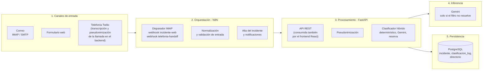

# Diagrama de Arquitectura del Sistema — Cinco Capas y Tres Canales

Representa las cinco capas de la arquitectura (Tabla `tab:capas`) y los tres canales
de entrada del sistema entregado (release `v1.2.5`). Reemplaza al diagrama de flujo de
un solo canal que se usaba antes como Figura `fig:arquitectura` (c-159).

Procedencia: Tabla `tab:capas` de la tesis, `n8n/workflow.json` (disparador IMAP,
webhook `incidente-web` y webhook `telefonia-handoff`), `docker-compose.yml` y
`App/Backend/app/routes/incidentes.py`. Los rótulos no llevan versiones de bibliotecas:
viven en la Tabla `tab:capas` y en la tabla de configuración evaluada frente a entregada.

