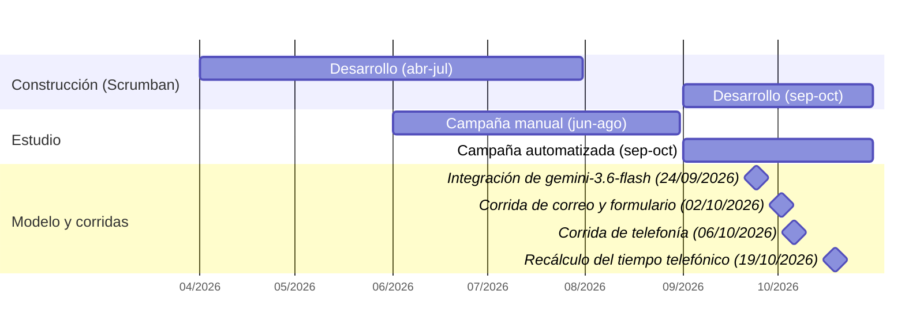

# Cronograma de la construcción, de las campañas de medición y de la versión del modelo

Fuente única de la cronología de la tesis (figura `fig:cronograma`,
`docs/Tesis/v10 (IA)/paper/figures/cronograma.png`; Anexo A de la tesis; descrita en la sección 6.6). Toda
mención de periodos en `01-introduccion.tex`, `04-marco-metodologico.tex`,
`06-implementacion.tex` y `08-discusion.tex` se deriva de este archivo. Change:
`c-135-cronologia-y-consistencia-redaccional` (B9 del dictamen CONEAU 2026-10-22).

**Reglas de procedencia (design D5).** Ninguna fecha se inventa ni se interpola; cada
elemento se dibuja con la precisión de su evidencia (mes o día). Las fechas de commit
son evidencia de actividad, no límites de iteración: ninguna se convirtió en inicio o
fin de una iteración.

**Estado de OQ-1 (RESUELTA PROVISIONALMENTE, 2026-10-25; pendiente de confirmación del
autor).** No hay fuente primaria de las fechas de las seis iteraciones: el campo de
iteración del tablero GitHub Projects no es legible con el token de esta máquina
(`gh project list --owner lucaGomezB` falla con "your authentication token is missing
required scopes [read:project]") y los autores no confirmaron los intervalos. Por la
regla (iv) de D5, las seis barras individuales quedan **pendientes de confirmación** y la
construcción se representa con la precisión disponible: dos barras de mes que cubren
los períodos de actividad de desarrollo registrados en el repositorio. Los autores
deben aportar el inicio y el fin de cada iteración (y confirmar si fueron de dos
semanas y contiguas) para reemplazar esas barras por las seis individuales.

## Diagrama

Las barras de "Construcción", "Campaña manual" y "Campaña automatizada" tienen
precisión de mes (se dibujan del primer al último día de cada mes); los hitos tienen
precisión de día.

Render: `npx -y @mermaid-js/mermaid-cli@11 -i <tmp>.mmd -o <tmp>.png -b white -s 2 -w 760`
(bloque `mermaid` extraído a un `.mmd` temporal fuera del repositorio; mmdc 11.17.0,
2026-10-25) y recorte de los márgenes blancos con Pillow 12.3.0 (caja mínima más 14 px)
antes de copiar el resultado a `docs/Tesis/v10 (IA)/paper/figures/cronograma.png`. En la
tesis la figura se reproduce en el Anexo A (decisión de paginación, design D12).

## Procedencia

Fecha de consulta de la evidencia: 2026-10-25. `git` y `gh` se ejecutaron desde la raíz
del repositorio, en solo lectura.

| Elemento | Fecha o intervalo | Precisión | Evidencia | Comando o documento que la reproduce |
|---|---|---|---|---|
| Desarrollo, primer período | abril a julio de 2026 | mes | Primer commit 2026-04-06 (`0d21a00`, "Initial commit"); 4 commits en abril, 16 en mayo, 79 en junio y 22 en julio; último commit del período 2026-07-10 | `git log --reverse --date=short --format='%ad %h %s' \| head`; `git log --date=format:'%Y-%m' --format='%ad' \| sort \| uniq -c` |
| Pausa de actividad | 2026-07-10 a 2026-09-10 (no se dibuja) | día | Sin commits entre esas fechas; 0 commits en agosto | `git log --format='%ad' --date=short \| sort -u` (brecha de 62 días) |
| Desarrollo, segundo período | septiembre a octubre de 2026 | mes | Primer commit tras la pausa 2026-09-10; 120 commits en septiembre y 338 en octubre (a 2026-10-25); changes c-27..c-124 archivados entre 2026-09-11 y 2026-10-22 | `git log --date=format:'%G-W%V' --format='%ad' \| sort \| uniq -c`; `ls openspec/changes/archive/` |
| Campaña manual | junio a agosto de 2026 | mes | Confirmación del autor, 2026-10-09 (T6, `docs/Tesis/Correcciones/dictamen-correcciones.md`, grupo "Trazabilidad y existencia de datos experimentales") | `grep -n "Ventana real" docs/Tesis/Correcciones/dictamen-correcciones.md` |
| Campaña automatizada | septiembre a octubre de 2026 | mes | Confirmación del autor, 2026-10-09 (T6, mismo registro); instrumentación de tiempos de extremo a extremo (c-39, archivado 2026-09-20) y corridas del corpus del 2026-10-02 y 2026-10-06 | Ídem; `ls openspec/changes/archive/ \| grep c-39` |
| Integración de `gemini-3.6-flash` | 2026-09-24 | día | Commit `11036be` ("migrar el clasificador a Gemini 3.6 Flash y timeout de 30s"); hasta ese commit el clasificador usó `gemini-2.5-flash` | `git log -S "gemini-3.6-flash" --date=short --format='%ad %h %s' -- App/Backend/app/config/settings.py`; `App/Backend/app/config/settings.py:78` |
| Corrida de correo y formulario (119 casos) | 2026-10-02 | día | c-68, `tasks.md` 6.4 ("EJECUTADA (2026-10-02 ...) web 53/53, correo 66/66") | `openspec/changes/archive/2026-10-09-c-68-corpus-ingesta-n8n/tasks.md` |
| Corrida de telefonía (81 casos) | 2026-10-06 | día | c-70, `tasks.md` 8.2 ("REALIZADO (2026-10-06): 81/81 casos telefónicos") | `openspec/changes/archive/2026-10-06-c-70-softphone-corpus-telefonia/tasks.md` |
| Recálculo del tiempo telefónico | 2026-10-19 | día | Commit `4602bf5` (c-77, "tiempo telefónico end-to-end"); decisión del autor del 2026-10-12 (grupo E de c-77) | `git log -1 --date=short --format='%ad %h %s' 4602bf5`; `openspec/changes/archive/2026-10-20-c-77-tesis-errores-estadisticos-inferenciales/tasks.md:93` |
| Iteraciones 1 a 6 (fechas individuales) | **pendiente de confirmación (OQ-1)** | — | Sin fuente primaria: tablero GitHub Projects ilegible (falta el scope `read:project`) y sin confirmación de los autores | `gh project list --owner lucaGomezB` |

## Anclas que no se dibujan (contexto y verificación de coherencia)

| Ancla | Fecha | Evidencia | Comando o documento |
|---|---|---|---|
| Primeras especificaciones para Gemini 2.5 | 2026-05-03 | Commit `c7ccdb1` | `git log --date=short --format='%ad %h %s' \| grep c7ccdb1` |
| Pull requests fusionados #1 a #7 (módulo de gestión de incidentes y frontend) | 2026-05-20 a 2026-05-22 | `gh pr list` | `gh pr list --state merged --limit 200 --json number,title,mergedAt` |
| Pull requests #8 a #27 (fundación OPSX, validación del flujo N8N, canales, evaluación, CI) | 2026-06-10 a 2026-06-12 | `gh pr list` | Ídem |
| Pull requests #28 a #31 | 2026-09-17 | `gh pr list` | Ídem |
| Changes archivados c-01 a c-10 | 2026-06-10 y 2026-06-11 | Prefijo de fecha de cada directorio | `ls openspec/changes/archive/` |
| Changes archivados c-11 a c-26 | 2026-07-02 y 2026-07-03 | Ídem | Ídem |
| Documento de arquitectura (`knowledge-base/08_arquitectura_propuesta.md`) | 2026-06-10 | Commit `0ceebe0` | `git log --diff-filter=A --date=short --format='%ad %h' -- knowledge-base/08_arquitectura_propuesta.md` |
| Contrato OpenAPI estático (`docs/openapi.json`) | 2026-06-11 | Commit `15f9516` (c-10) | `git log --diff-filter=A --date=short --format='%ad %h' -- docs/openapi.json` |
| Endurecimiento del clasificador determinístico (c-71) y calibración del cortocircuito (c-74), medidos sobre el corpus fuera de línea | 2026-10-05 y 2026-10-07 | Commits `1368fd8` y `d6bb474`; changes archivados 2026-10-06 y 2026-10-07 | `git log -1 --date=short --format='%ad %h %s' 1368fd8 d6bb474` |
| `evaluation/report.md` versionado | 2026-10-20 | Commit `8e1ca55` | `git log --date=short --format='%ad %h %s' -- evaluation/report.md` |
| Tags `v1.0.0` a `v1.1.1` (cierre documental, no iteraciones) | 2026-10-21 y 2026-10-22 | Tags | `git for-each-ref --sort=creatordate --format='%(refname:short) %(creatordate:short)' refs/tags` |

## Coherencia con el texto de la tesis

- **Iteraciones.** La tesis declara "seis iteraciones" (`04-marco-metodologico.tex`,
  `06-implementacion.tex`, `12-anexos.tex`) sin duración nominal ni calendario por
  iteración, hasta que los autores confirmen las fechas (OQ-1). La figura ubica la
  construcción en los dos períodos de actividad del repositorio.
- **Campañas.** La campaña manual (junio a agosto de 2026) no es una iteración de
  construcción; la campaña automatizada (septiembre a octubre de 2026) corresponde a la
  iteración 6 (validación experimental).
- **Versión del modelo.** `gemini-3.6-flash` se integró el 2026-09-24, antes de las
  corridas del corpus del 2026-10-02 y 2026-10-06; "junio de 2026" no es la fecha de la
  versión evaluada (en junio el clasificador usaba `gemini-2.5-flash`). Queda abierta
  (OQ-2) la pregunta de si hubo procesamiento automatizado del corpus entre el
  2026-09-01 y el 2026-09-23, con `gemini-2.5-flash`.
- **Entregables de la iteración 1.** El documento de arquitectura de `knowledge-base/`
  (2026-06-10) y el contrato OpenAPI estático (2026-06-11) son de junio de 2026 y no se
  atribuyen a la iteración 1 (ver `06-implementacion.tex`, sección 6.6).
- **Ajustes del clasificador (OQ-3, RESUELTA PROVISIONALMENTE).** c-71 (2026-10-05) y
  c-74 (2026-10-07) midieron sobre el corpus después de la corrida de correo y
  formulario (2026-10-02) y en paralelo a la de telefonía (2026-10-06); el ítem de la
  iteración 5 de `06-implementacion.tex` no afirma ausencia de exposición al corpus
  (verificado con `grep "sin exposici" "docs/Tesis/v10 (IA)/paper/sections/06-implementacion.tex"`),
  y su fecha no se declara (OQ-1).
