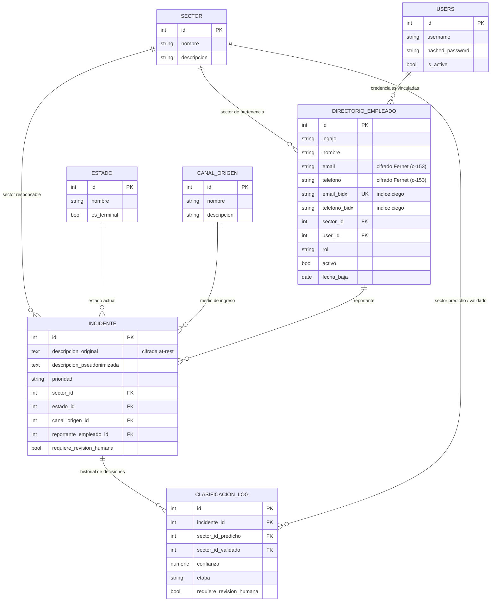

# Diagrama Entidad-Relación — Modelo de Datos (Anexo C)

Modelo de las siete entidades principales del sistema (`tab:entidades`) en la
configuración entregada (release `v1.2.5`), verificado contra `App/Backend/app/models/`. Las tablas auxiliares
(`incidente_evento`, `incidente_comentario`, `telefonia_ingreso`, etc.) quedan
fuera del alcance de este diagrama.

