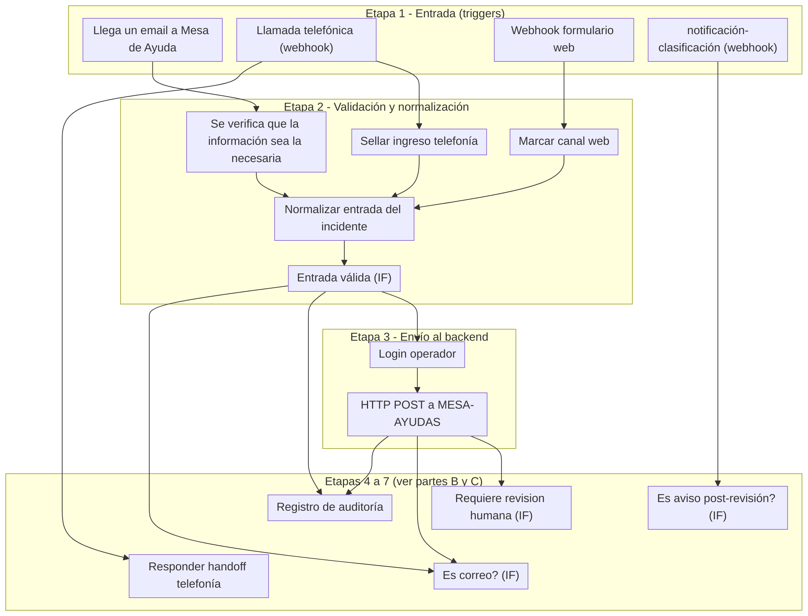
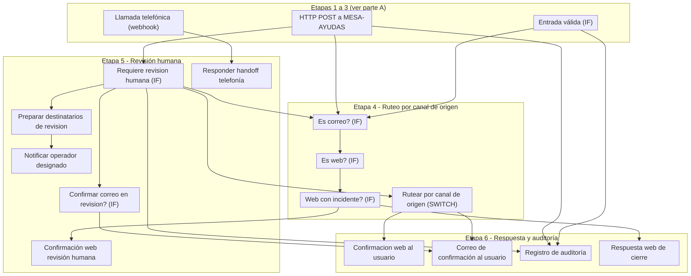
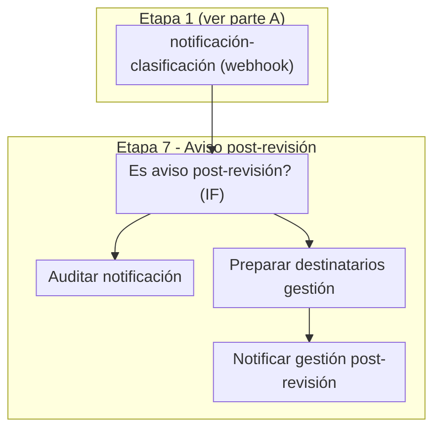

# Reconstruccion del flujo N8N — Anexo E

Diagrama esquematico reconstruido a partir de la exportacion versionada en
`n8n/workflow.json` (29 nodos operativos). Agrupa los nodos por etapa funcional.

> **Nota sobre el alcance**: no es una captura de la interfaz de N8N. Es una
> reconstruccion derivada del JSON exportado; la disposicion sobre el lienzo de la
> herramienta no coincide necesariamente con la de este esquema. Se mantiene en
> formato Mermaid (texto versionable) en lugar de una imagen binaria, para facilitar
> diffs en revisiones de codigo.

> **Figura dividida en tres partes** (observación N-11 del tribunal). La parte A abarca las
> etapas 1 a 3 (entrada, validación y envío al backend); la parte B, las etapas 4 a 6 (ruteo,
> revisión humana y respuesta); la parte C, la etapa 7 (aviso post-revisión). Los nodos de la
> sección «ver parte X» repiten, como referencia, nodos que se definen en otra parte; las
> conexiones entre partes se conservan.

### Parte A — Etapas 1 a 3

### Parte B — Etapas 4 a 6

### Parte C — Etapa 7

