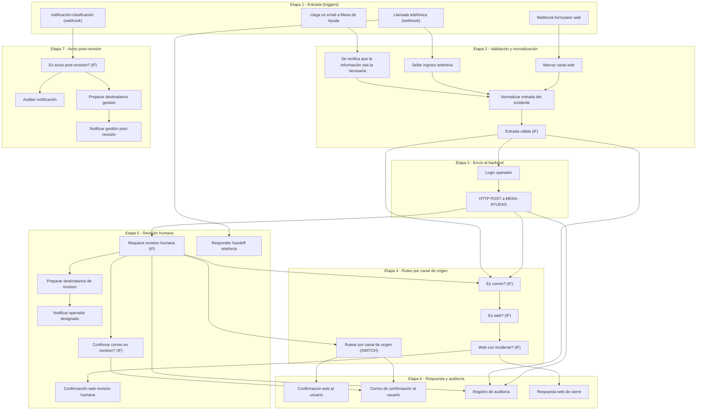

# Reconstruccion del flujo N8N — Anexo E

Diagrama esquematico reconstruido a partir de la exportacion versionada en
`n8n/workflow.json` (29 nodos operativos). Agrupa los nodos por etapa funcional.

> **Nota sobre el alcance**: no es una captura de la interfaz de N8N. Es una
> reconstruccion derivada del JSON exportado; la disposicion sobre el lienzo de la
> herramienta no coincide necesariamente con la de este esquema. Se mantiene en
> formato Mermaid (texto versionable) en lugar de una imagen binaria, para facilitar
> diffs en revisiones de codigo.

