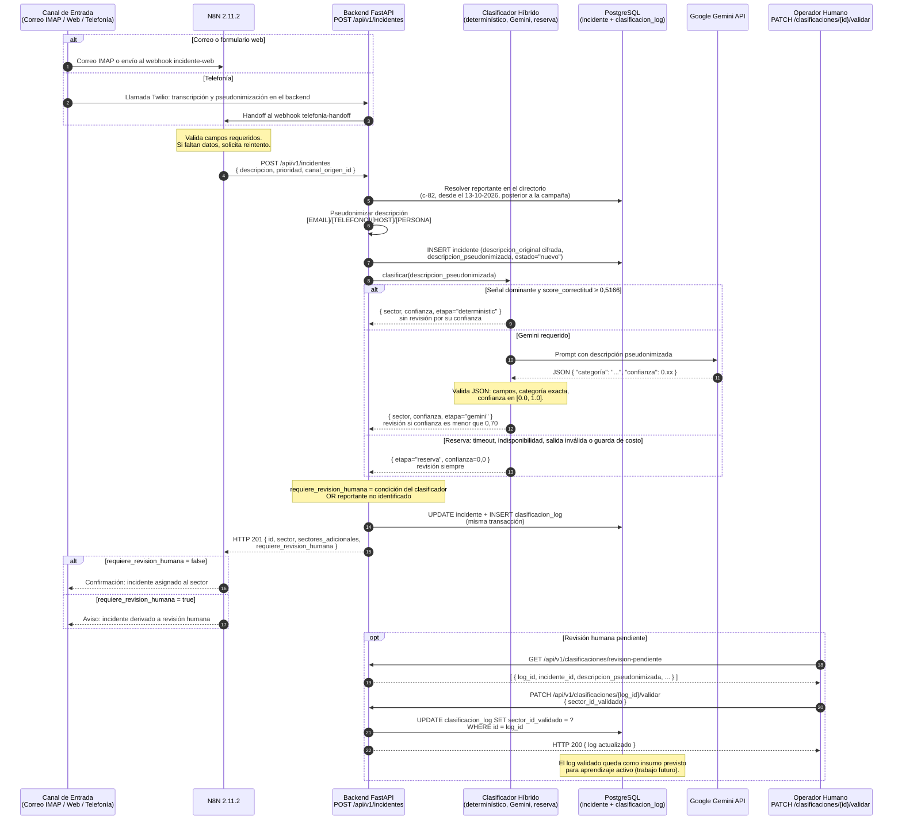

# Diagrama de Secuencia — Flujo Extremo a Extremo de un Incidente

Ilustra el flujo completo desde la recepción del incidente en un canal de entrada
hasta la confirmación al usuario o la derivación a revisión humana, en la
configuración entregada (release `v1.2.5`). El disparador por reportante no
identificado en el directorio es el change c-82 (13-10-2026), posterior a la
campaña de medición.

Procedencia: `n8n/workflow.json`, `App/Backend/app/routes/incidentes.py`,
`App/Backend/app/services/incidente_service.py` y
`App/Backend/app/classifiers/hybrid.py`.

## Notas

- **Doble representación**: `descripcion_original` se cifra at-rest con Fernet (Ley 25.326);
  `descripcion_pseudonimizada` es la única que consume el clasificador y la API.
- **Alcance por etapa**: la etapa determinística cortocircuita con señal dominante y
  `score_correctitud` ≥ 0,5166 y no deriva a revisión por su confianza; el umbral de 0,70
  rige solo sobre la salida de Gemini; la reserva fija confianza 0,0 y revisión siempre.
- **Disparador por directorio**: el backend deriva además a revisión cuando el reportante
  no se identifica en el directorio (c-82, desde el 13-10-2026, posterior a la campaña de
  medición), combinado por OR con la condición del clasificador.
- **Etapas del clasificador**: `deterministic` → `gemini` → reserva (error, timeout o guarda de costo).
- **N8N** actúa exclusivamente como orquestador de canales; toda la lógica de clasificación
  y persistencia reside en el backend FastAPI.
